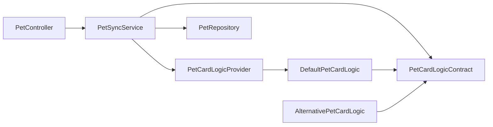

# Модульная карта серверной части Pawinder

Запись добавлена: студент (автор записи) — серверная часть, ПЗ №2 МДК.01.04. Клиентская часть описана в репозитории Android-приложения.

Стрелка `A → B` означает: исходный код A зависит от контракта или типов B.

| Модуль | Ответственность | Контракт | Зависимости | Место в репозитории | Статус | Автор записи |
|---|---|---|---|---|---|---|
| PetCardLogic | Выбор названия и описания карточки по данным ответа TheCatAPI/TheDogAPI | `PetCardLogicContract`: `resolveName`, `resolveDescription` | `BreedInfo` | `src/main/java/.../service/cardlogic/` | работает | автор отчёта |
| PetSyncService | Загрузка карточек из внешних API, проверка дубликатов, сохранение | `syncCats(count)`, `syncDogs(count)` | `PetCardLogicContract`, `PetCardLogicProvider`, `PetRepository`, `PetTypeRepository`, `CatDogApiItem` | `src/main/java/.../service/` | работает | автор отчёта |
| PetController | REST-интерфейс `/api/pets` | HTTP | `PetSyncService`, `PetRepository` | `src/main/java/.../controllers/` | работает | автор отчёта |
| Репозитории и entity | Доступ к таблицам `pet`, `type`, `user` и др. | Spring Data JPA | БД MySQL | `repository_interfaces/`, `entity_classes/` | работает | автор отчёта |

Легенда: «работает» — модуль реализован и вызывается потребителем; «план» — только намечен.
`PetCardLogicProvider` — точка сборки: единственное место, где известна конкретная реализация (`DefaultPetCardLogic`). `AlternativePetCardLogic` подключается только в тестах подмены.
Циклических зависимостей нет: проверено по импортам пакета `service.cardlogic` (он зависит только от `BreedInfo`).
